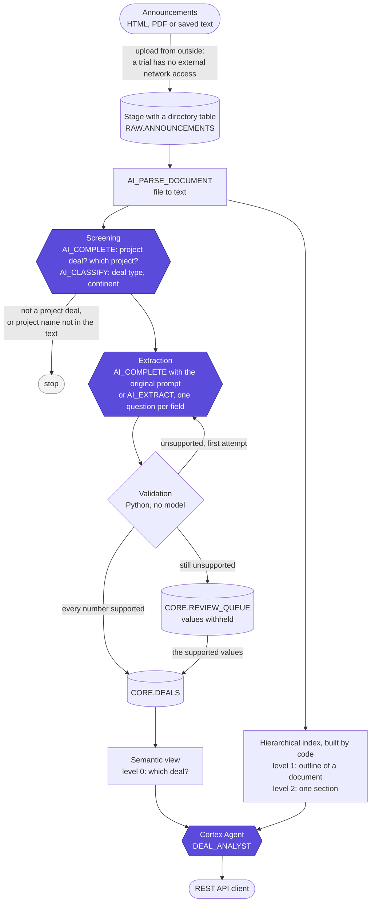

# Mining M&A announcements → a checked deal table, inside Snowflake

[](https://github.com/mbessalle/snowflake-motherlode/actions/workflows/ci.yml)

[](LICENSE)

A rebuild of [motherlode-data-pipeline](https://github.com/mbessalle/motherlode-data-pipeline) on Snowflake.
Deal announcements land on a stage, Cortex AI functions read them, Snowpark Python holds the pipeline, code
checks every extracted number against the announcement before it is written, and a Cortex Agent answers
questions over the result.

> **Status: everything except the model calls runs on Snowflake; no Cortex AI function has run yet.**
> On a trial account, the pipeline's Snowpark code has written 33 deals to the deal table from extractions
> saved by the original pipeline, with validation, retry and the review queue all running in Snowflake.
> The stored procedure, the task, the semantic view and the agent object exist. The Cortex AI functions are
> still refused with "not available for trial accounts" (a trial needs an accepted payment card), so there
> are no Cortex extraction, screening or agent results yet. [What was and was not tested](#status) is listed
> below and is updated as each part runs.

## Architecture



## What each Snowflake service does here

| Service | Its job in this project | Where |
|---|---|---|
| Stage, directory table, stream | Announcements land as files; the stream tells the pipeline which are new | [`sql/01_objects.sql`](sql/01_objects.sql) |
| `AI_PARSE_DOCUMENT` | Turns an HTML or PDF announcement into the text everything else reads | [`motherlode/cortex.py`](motherlode/cortex.py) |
| `AI_COMPLETE` | Screening (project deal or not, which project) and extraction with the original pipeline's prompt | [`motherlode/cortex.py`](motherlode/cortex.py) |
| `AI_CLASSIFY`, `AI_FILTER` | Deal type and continent from fixed lists; a second way to screen, for comparison | [`motherlode/cortex.py`](motherlode/cortex.py) |
| `AI_EXTRACT` | Document extraction with one question per field, measured against `AI_COMPLETE` on the same cases | [`motherlode/cortex.py`](motherlode/cortex.py) |
| Snowpark Python, stored procedure, task | The pipeline code; the procedure runs it inside Snowflake when new files arrive | [`motherlode/pipeline.py`](motherlode/pipeline.py), [`sql/03_pipeline_procedure.sql`](sql/03_pipeline_procedure.sql) |
| Semantic view | Tells the agent what the deal table's columns mean; the top level of the index | [`sql/04_semantic_view_agent.sql`](sql/04_semantic_view_agent.sql) |
| SQL functions and a Snowpark procedure | The hierarchical index over the announcement texts: outline, section, exact lookup. No embeddings | [`sql/05_hierarchical_index.sql`](sql/05_hierarchical_index.sql), [`motherlode/outline.py`](motherlode/outline.py) |
| Cortex Agent | Answers questions with the semantic view and the index functions as custom tools; called over REST | [`sql/04_semantic_view_agent.sql`](sql/04_semantic_view_agent.sql), [`scripts/agent.py`](scripts/agent.py) |
| Resource monitor, budget, one AI role | Spending controls | [`sql/00_account_guardrails.sql`](sql/00_account_guardrails.sql) |

A note on names: Snowflake's Document AI product (its UI and the `!PREDICT` method) was
[decommissioned on 16 March 2026](https://docs.snowflake.com/en/release-notes/bcr-bundles/un-bundled/bcr-2156).
Document extraction is now `AI_EXTRACT`, with `AI_PARSE_DOCUMENT` for text and layout, so those are what
this project uses.

## The model extracts, code decides

This is carried over unchanged from the original pipeline, and it is the part that does not depend on which
model or platform runs the extraction.

- [`motherlode/validate.py`](motherlode/validate.py) gives every extracted number a status: written in the
  announcement, derived from written amounts by a rule (a sum of tranches, a total split across projects,
  shares × price), or unsupported. Only unsupported values block a write.
- [`motherlode/process.py`](motherlode/process.py) gives an unsupported value one retry that names it. If it
  is still unsupported it is withheld and queued for a person, and the rest of the record is stored. A
  record that breaks the [Pydantic schema](motherlode/schema.py) is not written at all.
- The field list lives in one place, the prompt. The table DDL, the insert statement and the `AI_EXTRACT`
  questions are generated from it ([`motherlode/fields.py`](motherlode/fields.py),
  [`motherlode/ddl.py`](motherlode/ddl.py)), and tests fail if any of them drift.
- Schema checking has two layers, both generated from that field list. Snowflake's structured outputs
  (`response_format` on `AI_COMPLETE`, built in [`motherlode/cortex.py`](motherlode/cortex.py)) constrain
  the model's reply to the right keys and JSON types while it is written. Pydantic then checks what a JSON
  schema does not express here: percentage and coordinate ranges, ISO currency codes, real dates. Pydantic
  runs inside the Snowflake stored procedure, from Snowflake's own package channel. Snowflake's Data
  Quality Monitoring would be a third layer on the table, but it needs Enterprise edition and is not
  available on a trial.
- Every model reply is kept in `CORE.EXTRACTION_ATTEMPTS` with its validation report.

## Retrieval: an index to walk, not embeddings

The agent does not search the announcements by vector similarity. It reads them the way a person reads a
long paper: start from the table of contents and go only where the answer is.

| Level | What it holds | How the agent reaches it |
|---|---|---|
| 0 | The deal table: one row per transaction | The semantic view, or `FIND_DEALS(term)` |
| 1 | The outline of one announcement: number, heading, size and first sentence of each section | `DOCUMENT_OUTLINE(doc_id)` |
| 2 | One section | `READ_SECTION(doc_id, section)` |

`FIND_IN_DOCUMENT(doc_id, term)` adds an exact word or number lookup inside one document. Every step is a
plain SQL function, so each answer can be traced to the rows it read, and the whole index is built by a
Snowpark procedure with no model call ([`motherlode/outline.py`](motherlode/outline.py)).

At scale, on the source PDFs (see [Documents](#documents)): `BUILD_OUTLINES` cut 443 documents into
13,075 sections inside Snowflake in about two minutes, and the walk project → its documents → outline →
section was run for a real project with `FIND_PROJECTS`, `PROJECT_DOCUMENTS` and `DOCUMENT_OUTLINE`. One
weakness showed up there: the first sentence of a PDF is often letterhead, so those outline entries say
little until model-written summaries replace them.

Measured on the 33 eval announcements, built inside Snowflake on 16 November 2026:

| | |
|---|---|
| Sections | 223, between 401 and 3,164 characters, median 1,309 |
| Values written in the announcements that sit inside a single section | 96 of 96 |
| That section as a share of its document | median 16% |
| The outline as a share of its document | median 16% |
| Outline plus one median section, against reading the whole document | about 32% |

The last row is the best case: it assumes the reader picks the right section first. How often an agent
does that is not measured yet, because the agent cannot run until the AI features are enabled. Two limits
are also known: the outline's "summaries" are first sentences cut by code, and a press release with no
headings gets sections labelled by their first words. Model-written summaries can replace both later
without changing the structure.

Embedding search (Cortex Search) is left out on purpose for this corpus: the questions are about exact
terms and numbers in a few dozen structured documents, where a traceable lookup fits better than a
similarity ranking. It has not been measured against the index here.

## Evals

**Extraction.** [`evals/score.py`](evals/score.py) scores saved extractions on the original pipeline's 33
real press releases ([`evals/cases.jsonl`](evals/cases.jsonl)): how many extracted numbers the announcement
supports, and agreement with an analyst's hand-entered values.

The only numbers measured so far are the baseline. Pointed at the original pipeline's saved `gpt-6.1-terra`
replies, the scorer reproduces what that repository published, which shows the scorer and the ported
validator behave as the originals do:

| | First attempt | After the corrected retry |
|---|---|---|
| Extracted numbers supported by the article | 122 of 126 (97%) | 123 of 126 (98%) |
| Records with every number supported | 30 of 33 | 31 of 33 |
| Agreement with the analyst, where both have a value | | 83 of 108 (77%) |

These are OpenAI results from the original pipeline, not Snowflake results. The Snowflake rows
(`AI_COMPLETE` and `AI_EXTRACT` on the same cases) will be added when they have been run.

**Screening.** 43 labelled announcements ([`evals/screening_cases.jsonl`](evals/screening_cases.jsonl)).
Only 3 of them are not project deals, so this set says little about false positives until more negatives
are labelled.

**The same cases, replayed through Snowflake.** [`scripts/replay_baseline.py`](scripts/replay_baseline.py)
feeds those saved replies into the pipeline code running against the Snowflake account, in place of the
model call. Measured on 16 November 2026 and read back from the tables:

| | Count |
|---|---|
| Deals written to `CORE.DEALS` | 33 |
| Complete (every number supported) | 31 |
| Partial (unsupported values withheld) | 2 |
| Second attempts recorded in `CORE.EXTRACTION_ATTEMPTS` | 3 |
| Entries in `CORE.REVIEW_QUEUE` | 2 |

These match the scorer's numbers above (31 of 33 records fully supported, 3 retried), which is the point:
the validation, retry, quarantine and storage path behaves on Snowflake as it does offline. The rows are
marked `REPLAY gpt-6.1-terra`. They are not Cortex output.

**A larger set: 236 cases built from the source PDFs.** 33 cases give 126 checked values, which leaves
the 97% figure uncertain by about three points. [`scripts/build_pdf_cases.py`](scripts/build_pdf_cases.py)
pairs each row of the analyst's deal table for one region with its project's PDFs and writes
[`evals/pdf_cases.jsonl`](evals/pdf_cases.jsonl). A project often has several PDFs about the same sale, so
every PDF is scored by how many of the row's values are written in it, and the best one becomes the case
document. No model is involved.

What can be checked against a document follows the analyst's field definitions: scraped fields are written
in the announcement; calculated fields (the aggregate, the shares value) follow a formula; the share price
is market data from the announcement date and is not in the document at all.

| | |
|---|---|
| Rows in the table / without a PDF folder / cases | 249 / 13 / 236 |
| Case documents: digital / mixed | 214 / 22 |
| Projects with several PDFs where the chosen one holds every value any of them holds | 89 of 95 |
| Aggregate equals cash + exploration commitment + shares value | 182 of 182 rows |
| Shares value, 109 rows: stated in the document / computed as shares × price / both / unexplained | 43 / 15 / 3 / 48 |

| Scraped field | Written in the case document | Not written, but derived by a rule | Chance matches of the rule (control) |
|---|---|---|---|
| Royalty | 76 of 84 (90%) | 0 | |
| Interest acquired | 155 of 194 (80%) | 0 | |
| Shares issued | 51 of 77 (66%) | 20 (19 sums, 1 split) | 4 / 4 |
| Cash payments | 68 of 144 (47%) | 28 (24 sums, 4 splits) | 12 / 6 |
| Exploration commitment | 16 of 47 (34%) | 14 (6 sums, 8 splits) | 5 / 2 |
| Project area | 11 of 133 (8%) | 90 (km² in the document, hectares in the row) | 0 / 2 |
| All scraped values | 377 of 679 (56%) | 152, so 529 of 679 (78%) together | |

This table is not an extraction score. It measures the ground truth: how many of the analyst's values can
be found in the document. A value that is not written as such can still follow from the document by the
original pipeline's extraction rules, and the case file records which rule explains it:

- **sum**: "sum all forms of a payment type", so a cash payment is the sum of tranches the announcement
  lists separately (two or three amounts written in the document).
- **split**: a value shared between projects is divided equally (a written total, or a sum of two,
  divided between 2 and 6 projects).
- **km² to ha**: the announcement gives the area in km² and the row holds it in hectares.

A sum of written amounts can match by chance, so the same tests were run with every stored value
multiplied by 1.13 and by 0.87, values that should not match. The last column gives how many of those
wrong values the rule still "explained". The area rule is reliable (0 and 2 chance matches against 90).
The share-count sums are mostly real. For cash, up to about 12 of the 28 may be chance, so a derived
cash value is "probably from the document", not confirmed.

A shares value has two legitimate origins, as the original pipeline's extraction rules set out in order
of priority: the announcement states what the share payment is worth, or it is computed from the number
of shares and a share price, taken from the announcement or, failing that, the last traded price on the
listing site. 61 of the 109 rows are explained by one of the two. The other 48 match neither the document
nor the stored price. The fallback price can be checked only where a project folder holds a print of the
listing page: that is so for 1 of the 48, and its printed price does not explain the value. Scoring an
extractor on this set is not built yet.

**Converted amounts.** An earlier sheet holds the same deals converted to US dollars, by the rule
"amount × the exchange rate on the document date".
[`scripts/check_conversion.py`](scripts/check_conversion.py) tests that rule with daily public reference
rates. Of 108 converted cash figures, 25 are within 2% of amount × that day's rate, 21 more are within 5%
and 62 are further off; the converted figures run a median 3% above the public rate. So the rule holds
approximately, the rates actually used were not the public daily ones, and converted figures are kept out
of document scoring.

**Agent.** [`evals/agent_questions.jsonl`](evals/agent_questions.jsonl) holds 10 questions, each with a SQL
query that computes the true answer from the deal table. An answer passes only if it contains that number.

## Documents

**Source PDFs, checked for a text layer before anything reads them.** The larger document set is 464
announcement PDFs filed in 244 project folders. [`scripts/inventory_pdfs.py`](scripts/inventory_pdfs.py)
reads every file with code, no model, and records the result in
[`data/pdf_inventory.jsonl`](data/pdf_inventory.jsonl):

| | |
|---|---|
| PDFs | 464, of which 54 are byte-identical copies of another file |
| Distinct documents | 410, with 4,596 pages |
| Digital (every page has a text layer) | 376 |
| Mixed (some pages are images only) | 34 |
| Fully scanned | 0 |
| Pages that need OCR | 58 |

The check decides the route: a digital document goes to `AI_PARSE_DOCUMENT` in layout mode, and the 58
image-only pages need its OCR mode. Both wait on the AI features. Until then
[`scripts/load_source_pdfs.py`](scripts/load_source_pdfs.py) has put all PDFs on the Snowflake stage,
registered the 410 documents with their project, page count and check result, and stored the text layer
read with `pypdf` as a labelled stand-in. That stand-in has no OCR, so the 58 image-only pages contribute
no text yet. The PDFs themselves are not in this repository.

**The 43 eval announcements.**

[`scripts/fetch_documents.py`](scripts/fetch_documents.py) made one plain request per case to the public
press-release URL. Of 43 cases, 14 were downloaded as published (13 HTML, 1 PDF). The other 29 sites
refused the request, timed out or served a page without the headline; for those, the text saved by the
original pipeline is used as a `.txt` file. Nothing was done to get around a refusal.
[`data/manifest.jsonl`](data/manifest.jsonl) records which is which. The documents themselves are other
people's press releases and are not committed.

## Cost

A trial account's resource monitor covers warehouses only, and a budget on AI services notifies without
stopping anything. So the cap is enforced in code: [`motherlode/cost.py`](motherlode/cost.py) estimates a
step from Snowflake's published rates (Service Consumption Table effective 12 November 2026) and
`SpendGuard.authorise` refuses to start a step that would pass the cap, from a local ledger.

Estimate from the documents on disk (`python scripts/estimate_cost.py`), not a measurement:

| Step | Estimated USD of trial balance |
|---|---|
| `AI_PARSE_DOCUMENT`, layout mode, 14 files, about 106 pages | 0.78 |
| Screening, `AI_COMPLETE` claude-haiku-4-5, 43 documents | 0.08 |
| Deal type and continent, `AI_CLASSIFY`, 43 documents | 0.30 |
| Screening comparison, `AI_FILTER`, 43 documents | 0.15 |
| Extraction, `AI_COMPLETE` claude-sonnet-5, 33 cases, one pass | 0.83 |
| Extraction, `AI_EXTRACT`, 33 cases, one pass | 1.73 |
| **One full pass** | **3.86** |
| Warehouse, extra small, per hour running | 2.60 |

Agent runs and repeated passes come on top. Measured spend will replace this table.

## Status

Tested, offline, in CI (133 tests, no account or network needed):

- The validator and schema, with the original pipeline's tests.
- The extract, validate, retry, quarantine loop, at every exit.
- Building each Cortex statement and reading each documented reply shape.
- The Snowpark steps end to end against a stand-in session that records every statement and its parameters.
- The spending guard, the generated DDL, the agent answer check and the eval scorer.
- Locally only (it needs the original pipeline's cache): the scorer reproduces the published baseline.

Run on a Snowflake trial account (Standard edition, AWS EU Frankfurt) on 16 November 2026:

- [`sql/00_account_guardrails.sql`](sql/00_account_guardrails.sql): every statement succeeded. Read back:
  all three warehouses are under the 20-credit resource monitor with a 60 second auto-suspend.
- [`sql/01_objects.sql`](sql/01_objects.sql) and [`sql/02_deals_table.sql`](sql/02_deals_table.sql): the
  stage, the stream and the tables exist and are owned by the pipeline role. Two mistakes in the first
  version were found by running it and fixed (a `GRANT` on three schemas in one statement; an `&` in a
  comment that the Snowflake CLI read as a variable).
- Key-pair login through Snowpark, and the upload of the 43 documents to the stage.
- **The pipeline after the model call**, through [`scripts/replay_baseline.py`](scripts/replay_baseline.py):
  `DOCUMENT_TEXT`, `EXTRACTION_ATTEMPTS`, `DEALS` and `REVIEW_QUEUE` are written by the Snowpark code with
  bind parameters, `PARSE_JSON` and one typed cast per column. Counts are in [Evals](#evals).
- **The stored procedure**: the package is uploaded as a zip, `PROCESS_NEW_ANNOUNCEMENTS` is created with
  Python 3.12 and `pydantic` from Snowflake's package channel, and a call with a limit of 0 documents
  imports the package, runs and writes its summary to `RUN_LOG`. The **task** is created and suspended,
  and the stage stream reports the uploaded files.
- **The semantic view** is created and answers a `SEMANTIC_VIEW(...)` query with metrics by dimension.
  **The agent object** `DEAL_ANALYST` is created from its specification, with the semantic view and the
  four index functions as its tools.
- **The hierarchical index**: `BUILD_OUTLINES` runs inside Snowflake and writes 223 sections for 33
  documents; `FIND_DEALS`, `DOCUMENT_OUTLINE`, `FIND_IN_DOCUMENT` and `READ_SECTION` were called in that
  order for a real deal and returned the matching deal, its outline, the section naming the royalty, and
  that section's text.
- The 10 agent eval queries all run and return values from the deal table.
- [`scripts/smoke_test.py`](scripts/smoke_test.py): `AI_COMPLETE`, `AI_CLASSIFY`, `AI_FILTER`, `AI_EXTRACT`,
  `AI_PARSE_DOCUMENT` and `AI_COUNT_TOKENS` were each refused with error 399258, "is not available for
  trial accounts". This matches the documentation: AI features on a trial need a payment card on file.

Not tested yet, all waiting on the AI features being enabled:

- Every statement in [`motherlode/cortex.py`](motherlode/cortex.py): whether named arguments accept bind
  parameters as written, and whether `AI_PARSE_DOCUMENT` accepts HTML files. The refusal above came before
  Snowflake looked at the arguments.
- Extraction and screening by Cortex: no `AI_COMPLETE` or `AI_EXTRACT` result has been measured. The
  `CONTINENT` and `DEAL_CATEGORY` columns are empty because they come from `AI_CLASSIFY`.
- Running the agent: only creating the object was checked, so whether it walks the index well, and
  whether the custom tool specification is accepted at run time, is unknown.
- The REST call in [`scripts/agent.py`](scripts/agent.py): the authentication header and the response shape.
- `METERING_HISTORY` column names in [`scripts/spend_report.py`](scripts/spend_report.py).

[`scripts/smoke_test.py`](scripts/smoke_test.py) is the first thing to run on an account: one small call
per service, printing Snowflake's own message for each.

Not built: Snowflake's native agent evaluations, and automatic discovery of new announcements (the original
pipeline does that outside Snowflake).

Not built yet, data being collected: a small ML model trained and served in Snowflake (a headline
classifier: project transaction or not). The 43 labelled cases are too few to train on, so
[`scripts/collect_headlines.py`](scripts/collect_headlines.py) adds the public news sitemap's headlines to
[`data/headlines.jsonl`](data/headlines.jsonl) once a day through a GitHub Actions workflow. Its
`deal_words` flag is a weak label from a regular expression, not a human judgement.

## Run it

```bash
python -m venv .venv && . .venv/bin/activate
pip install ".[dev]"
pytest                               # 133 tests, offline
ruff check .
python scripts/estimate_cost.py      # needs data/documents; see scripts/fetch_documents.py
```

With an account (untested, see Status): run `sql/00` to `sql/02`, copy `.env.example` to `.env`, then

```bash
pip install ".[snowflake]"
python scripts/smoke_test.py
python scripts/run_pipeline.py upload
python scripts/run_pipeline.py run --extractor claude-sonnet-5 --limit 3
python scripts/run_pipeline.py export --extractor claude-sonnet-5
```

## Layout

| Path | What it holds |
|---|---|
| [`motherlode/validate.py`](motherlode/validate.py), [`schema.py`](motherlode/schema.py), [`prompts.py`](motherlode/prompts.py) | Byte-identical copies from the original pipeline |
| [`motherlode/process.py`](motherlode/process.py) | The extract, validate, retry, quarantine loop |
| [`motherlode/cortex.py`](motherlode/cortex.py) | Cortex statements and reply parsing |
| [`motherlode/pipeline.py`](motherlode/pipeline.py) | The Snowpark steps and the stored procedure's handler |
| [`motherlode/cost.py`](motherlode/cost.py) | Published rates, estimates and the spending guard |
| [`motherlode/fields.py`](motherlode/fields.py), [`ddl.py`](motherlode/ddl.py) | The field list and what is generated from it |
| [`sql/`](sql/) | Guardrails, objects, the deal table, the procedure and task, search, semantic view and agent, teardown |
| [`scripts/`](scripts/) | Fetch documents, estimate cost, smoke test, run the pipeline, spend report, agent client |
| [`evals/`](evals/) | Cases, the scorer and the agent question set |
| [`tests/`](tests/) | Offline tests |
