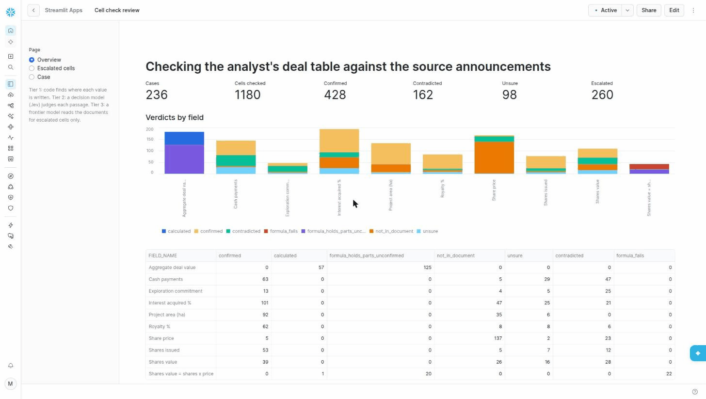
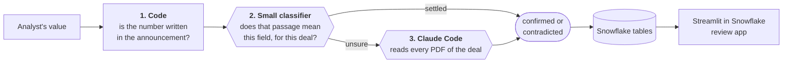

# Checking a mining-deal database against its sources, with Snowflake and LLMs

[](https://github.com/mbessalle/snowflake-motherlode/actions/workflows/ci.yml)

[](LICENSE)

An analyst built a table of 236 mining deals by hand. This project checks every value in it against the
announcements the deals come from, **1,180 values for 0.05 USD**, finds the errors, and puts the results in
Snowflake for review in a Streamlit app. The principle throughout: **a model reads and proposes, code
decides what is written**, and every number must be found in its source or derived from it by a stated rule.

Scope, plainly: the value check ran outside Snowflake, with code, a small classifier through OpenRouter and
Claude Code. Snowflake holds the extraction pipeline, the tables, the document index and the review app. The
Cortex AI calls are written and unit-tested but have not run yet, because Snowflake refuses them on trial
accounts ([where it stands](#where-it-stands)).



A Streamlit in Snowflake app runs behind the account's login, so this recording of the deployed app stands
in for a public link.

## Results

- **1,180 values checked against 410 source PDFs: 428 confirmed, 162 contradicted**, each contradiction with
  a proposed correction. In a sample read in full by a larger model, the analyst was wrong in 9 of the 11
  contradicted values that could be decided.
- **The errors are real and systematic**: share prices rounded to two decimals, buyers who are in fact the
  seller, a share price that cannot belong to the named company.
- **Cheap where it can be, expensive only where it must be**: code settles what it can, a small classifier
  (about 0.00006 USD a question) judges meaning, and only the values those two cannot settle go to a
  full-document review by Claude Code.
- **Measured, not assumed**: the classifier's thresholds were set from blind labels, made by agents that
  never saw its answers; an audit of every file they read checks it.

Seven of the checked values ([`evals/sample_rows.jsonl`](evals/sample_rows.jsonl)):

| Deal | Value | Analyst | Check | Proposed | Full-document review |
|---|---|---|---|---|---|
| Elizabeth Hill | Exploration commitment | 700,000 | contradicted | 1,000,000 | 1,000,000: analyst wrong, proposal right |
| Eagle Downs | Cash payments | 20,100,000 | contradicted | 30,000,000 | 30,000,000: analyst wrong, proposal right |
| Lakewood Mill | Share price | 0.82 | contradicted | 0.76 | 0.76: analyst wrong, proposal right |
| Katanning | Cash payments | 10,760,000 | contradicted | 3,120,000 | 10,760,000: analyst right; the proposal was one tranche |
| Fiery Creek | Shares issued | 26,500,000 | unsure | 223,391,506 | 26,500,000: analyst right; the proposal was the company's total shares on issue |
| Achilles | Shares value | 301,500 | contradicted | 250,000 | 450,000: analyst and proposal both wrong |
| Sandover Additional Claims | Cash payments | 720,250 | unsure | 1,075,000 | 1,075,000: analyst wrong, proposal right |

## How it works



The same three steps choose which of a project's PDFs announce each deal. The extraction pipeline, in
Snowpark, follows the same rule: the model extracts, code checks each number against the source, retries
with the reasons, and sends what still fails to a review queue instead of the deal table.

## Built with

**Snowflake**: Snowpark Python, stages and directory tables, streams, stored procedures and tasks, a semantic
view, a Cortex Agent specification, a hierarchical document index, Streamlit in Snowflake, resource monitors.
**Around it**: Python, Pydantic, OpenTelemetry and Jaeger, Claude Code agents in isolated git worktrees,
GitHub Actions, 290 offline unit tests.

## Engineering practice

- **Review by critic agents**: four rounds of independent critic agents, each in its own git worktree,
  reviewed the code, the data and the documentation. Every confirmed finding became a failing test first;
  they found real bugs, among them metres read as millions and a rule that accepted invented amounts.
- **Every step traced**: OpenTelemetry spans with the inputs, outputs and evidence of each decision.
- **Spend capped in code**: Snowflake's AI costs are estimated from the published rates and checked against a
  cap before a step runs; the app runs on a warehouse that suspends a minute after the last viewer.
- **Client data handled as such**: the analyst's table stays private; this repository publishes the code, the
  counts ([`evals/results_summary.json`](evals/results_summary.json), checked by a test against the private
  files) and the seven rows above.

## Where it stands

Run on a Snowflake trial account: the Snowpark pipeline (it wrote 33 deals, with validation, retry and a
review queue), the stored procedure, the semantic view's queries, the document index and the review app.
Deployed: the task and the Cortex Agent. **The Cortex AI calls themselves have not run yet**: Snowflake
refuses them on trial accounts until a payment card is accepted, and a support case is open. The 33 deals
came from extractions saved by the original pipeline.

Next, once Cortex is enabled: extraction with `AI_EXTRACT` against `AI_COMPLETE` on the 33 cases, the agent's
10 test questions, and the measured cost from Snowflake's own usage views in place of the estimate.

## Quickstart

```bash
python -m venv .venv && . .venv/bin/activate
pip install ".[dev]"
pytest                               # 290 tests, offline (8 skip without the private data)
```

With a Snowflake account: the SQL in [`sql/`](sql/), then [`scripts/run_pipeline.py`](scripts/run_pipeline.py);
the steps are in the [engineering record](docs/engineering-record.md#run-it).

## Repository

| Path | What |
|---|---|
| [`motherlode/`](motherlode/) | The pipeline: Cortex calls, validation, retry, the Snowpark steps, the document index |
| [`sql/`](sql/) | Account guardrails, objects, the procedure and task, the index, semantic view and agent, the review app |
| [`streamlit_app/`](streamlit_app/) | The review app in Streamlit in Snowflake |
| [`scripts/`](scripts/) | The three-step check, document choice, loading results into Snowflake |
| [`evals/`](evals/) | Scorers, the published counts and example rows |
| [`.claude/agents/`](.claude/agents/) | Briefs of the critic, labelling and review agents |
| [`tests/`](tests/) | 290 offline tests |

**[Engineering record](docs/engineering-record.md)**: the architecture, each Snowflake service, how every
number was measured, cost, and exactly what was and was not tested.

This project rebuilds [motherlode-data-pipeline](https://github.com/mbessalle/motherlode-data-pipeline) on
Snowflake. MIT licensed.
