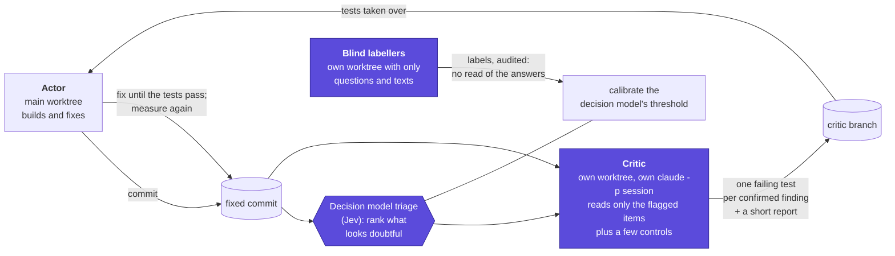
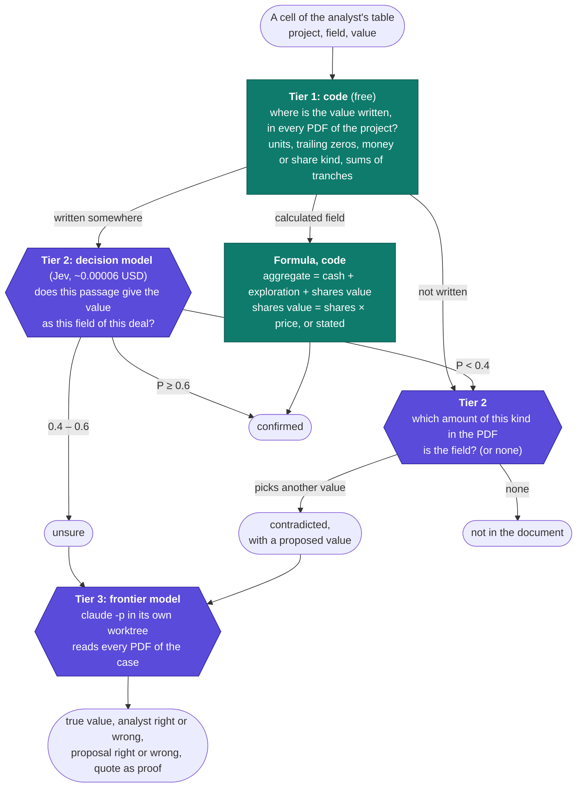
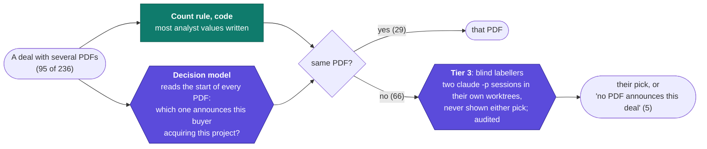
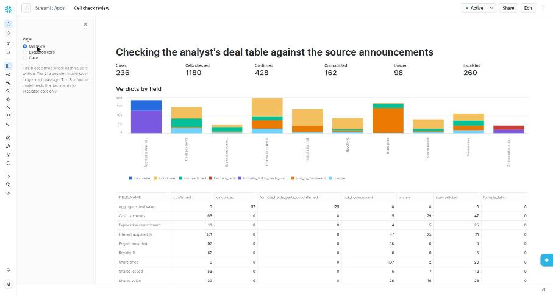
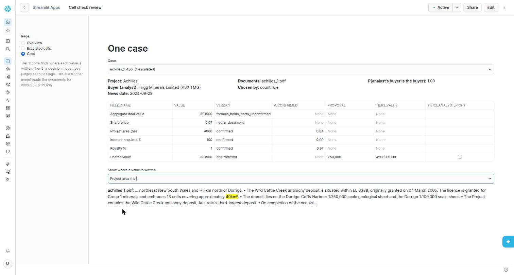

# Mining M&A announcements → a checked deal table, inside Snowflake

[](https://github.com/mbessalle/snowflake-motherlode/actions/workflows/ci.yml)

[](LICENSE)

A rebuild of [motherlode-data-pipeline](https://github.com/mbessalle/motherlode-data-pipeline) on Snowflake.
Deal announcements land on a stage, Cortex AI functions read them, Snowpark Python holds the pipeline, code
checks every extracted number against the announcement before it is written, and a Cortex Agent answers
questions over the result.

> **Status: no Cortex AI function has run yet.** Trial accounts are refused them ("not available for trial
> accounts"; a trial needs an accepted payment card, and a support case is open). What is deployed on a
> Snowflake trial account: the stage, tables and Snowpark pipeline, which wrote 33 deals from extractions
> saved by the original pipeline, with validation, retry and the review queue running in Snowflake; the
> stored procedure (run with a limit of 0 documents), the task (suspended), the semantic view, the agent
> object, the hierarchical index, and a Streamlit review app. [What was and was not tested](#status).

**What is built and measured so far**

The checks below run on a laptop: code, a small classification model called through OpenRouter (TypeSafe's
Jev, which answers closed yes/no or pick-one questions with probabilities, about 0.00006 USD a question),
and Claude Code sessions. Their results are loaded into Snowflake and reviewed in the Streamlit app.

- **An evaluation set from 410 source PDFs**: 236 deals pairing an analyst's table rows with the
  announcements that state each deal, with the evidence for every value recorded ([details](#evals)).
- **Every analyst value checked in three tiers**: code finds where each value is written; the small model
  judges what each passage means; only the values those two cannot settle go to a larger model (a
  `claude -p` session) that reads the whole document. 1,180 values checked for 0.05 USD: 428 confirmed, 162
  contradicted with a proposed correction. The third tier has reviewed 31 of the 260 escalated values so far
  ([details](#checking-every-cell-three-tiers)).
- **The same tiers for choosing each deal's documents**: the small model picks which PDF announces the deal
  and which others give its terms; where it disagrees with the old counting rule, labelling agents decide.
  On the 66 deals where the two disagreed, all labelled, counting was right 25 times and the model 34; a
  second form of the question, chosen after seeing those labels, was right 41 times
  ([details](#which-pdf-announces-the-deal)).
- **Thresholds set from blind labels**: before any of the small model's answers was used, labelling agents
  in an isolated git worktree answered the same questions without seeing them, and an audit of every file
  they read confirmed they did not look.
- **Actor-critic review in isolated worktrees**: critic agents, each in its own git worktree (the later ones
  as their own `claude -p` sessions), reviewed the code, the data and this README; every confirmed finding
  became a failing test first. Four rounds (one critic, then three in parallel, then a split critic, then a
  README critic) found and fixed real errors, among them metres read as millions and a rule that accepted
  invented amounts.
- **A review app in Streamlit in Snowflake**: the results in Snowflake tables, with an app that shows the
  verdicts and highlights each value in its own announcement text ([details](#review-app-in-snowflake)).
- **Traces**: the case builder, validator, scorer and judge write OpenTelemetry spans with the inputs,
  outputs and evidence of each step, to local files and to a Jaeger viewer when it is configured.
- **Findings for the analyst** (the client's own table): share prices rounded to two decimals, rows where
  the named buyer is the seller, a price that cannot belong to the named company.
- 285 offline tests (3 need private data and skip without it); CI on every pull request.

## Architecture


## What each Snowflake service does here

| Service | Its job in this project | Where |
|---|---|---|
| Stage, directory table, stream | Announcements land as files; the stream tells the pipeline which are new | [`sql/01_objects.sql`](sql/01_objects.sql) |
| `AI_PARSE_DOCUMENT` | Turns an HTML or PDF announcement into the text everything else reads | [`motherlode/cortex.py`](motherlode/cortex.py) |
| `AI_COMPLETE` | Screening (project deal or not, which project) and extraction with the original pipeline's prompt | [`motherlode/cortex.py`](motherlode/cortex.py) |
| `AI_CLASSIFY`, `AI_FILTER` | Deal type and continent from fixed lists; a second way to screen, for comparison | [`motherlode/cortex.py`](motherlode/cortex.py) |
| `AI_EXTRACT` | Document extraction with one question per field, to be measured against `AI_COMPLETE` on the same cases (not run yet: Cortex is refused on the trial) | [`motherlode/cortex.py`](motherlode/cortex.py) |
| Snowpark Python, stored procedure, task | The pipeline code; the procedure runs it inside Snowflake when new files arrive | [`motherlode/pipeline.py`](motherlode/pipeline.py), [`sql/03_pipeline_procedure.sql`](sql/03_pipeline_procedure.sql) |
| Semantic view | Tells the agent what the deal table's columns mean; the top level of the index | [`sql/04_semantic_view_agent.sql`](sql/04_semantic_view_agent.sql) |
| SQL functions and a Snowpark procedure | The hierarchical index over the announcement texts: outline, section, exact lookup. No embeddings | [`sql/05_hierarchical_index.sql`](sql/05_hierarchical_index.sql), [`motherlode/outline.py`](motherlode/outline.py) |
| Cortex Agent | Answers questions with the semantic view and the index functions as custom tools; called over REST | [`sql/04_semantic_view_agent.sql`](sql/04_semantic_view_agent.sql), [`scripts/agent.py`](scripts/agent.py) |
| Resource monitor, budget, one AI role | Spending controls | [`sql/00_account_guardrails.sql`](sql/00_account_guardrails.sql) |

A note on names: Snowflake's Document AI product (its UI and the `!PREDICT` method) was
[decommissioned on 16 March 2026](https://docs.snowflake.com/en/release-notes/bcr-bundles/un-bundled/bcr-2156).
Document extraction is now `AI_EXTRACT`, with `AI_PARSE_DOCUMENT` for text and layout, so those are what
this project uses.

## The model extracts, code decides

This is carried over from the original pipeline, with the fixes listed in the layout table below, and it is the part that does not depend on which
model or platform runs the extraction.

- [`motherlode/validate.py`](motherlode/validate.py) gives every extracted number a status: written in the
  announcement, derived from written amounts by a rule (a sum of tranches, a total split across projects,
  shares × price), or unsupported. Only unsupported values block a write.
- [`motherlode/process.py`](motherlode/process.py) gives an unsupported value one retry that names it. If it
  is still unsupported it is withheld and queued for a person, and the rest of the record is stored. A
  record that breaks the [Pydantic schema](motherlode/schema.py) is not written at all.
- The field list lives in one place, the prompt. The table DDL, the insert statement and the `AI_EXTRACT`
  questions are generated from it ([`motherlode/fields.py`](motherlode/fields.py),
  [`motherlode/ddl.py`](motherlode/ddl.py)), and tests fail if any of them drift.
- Schema checking has two layers, both generated from that field list. Snowflake's structured outputs
  (`response_format` on `AI_COMPLETE`, built in [`motherlode/cortex.py`](motherlode/cortex.py)) constrain
  the model's reply to the right keys and JSON types while it is written. Pydantic then checks what a JSON
  schema does not express here: percentage and coordinate ranges, ISO currency codes, real dates. Pydantic
  runs inside the Snowflake stored procedure, from Snowflake's own package channel. Snowflake's Data
  Quality Monitoring would be a third layer on the table, but it needs Enterprise edition and is not
  available on a trial.
- Every model reply is kept in `CORE.EXTRACTION_ATTEMPTS` with its validation report.

## Retrieval: an index to walk, not embeddings

The agent does not search the announcements by vector similarity. It reads them the way a person reads a
long paper: start from the table of contents and go only where the answer is.

| Level | What it holds | How the agent reaches it |
|---|---|---|
| 0 | The deal table: one row per transaction | The semantic view, or `FIND_DEALS(term)` |
| 1 | The outline of one announcement: number, heading, size and first sentence of each section | `DOCUMENT_OUTLINE(doc_id)` |
| 2 | One section | `READ_SECTION(doc_id, section)` |

`FIND_IN_DOCUMENT(doc_id, term)` adds an exact word or number lookup inside one document. Every step is a
plain SQL function, so each answer can be traced to the rows it read, and the whole index is built by a
Snowpark procedure with no model call ([`motherlode/outline.py`](motherlode/outline.py)).

At scale (see [Documents](#documents)): `BUILD_OUTLINES` cut 443 documents (the 410 distinct source PDFs
and the 33 eval announcements) into
13,075 sections inside Snowflake in about two minutes, and the walk project → its documents → outline →
section was run for a real project with `FIND_PROJECTS`, `PROJECT_DOCUMENTS` and `DOCUMENT_OUTLINE`. One
weakness showed up there: the first sentence of a PDF is often letterhead, so those outline entries say
little until model-written summaries replace them.

Measured on the 33 eval announcements, built inside Snowflake on 16 November 2026:

| | |
|---|---|
| Sections | 223, between 401 and 3,164 characters, median 1,309 |
| Values written in the announcements that sit inside a single section | 96 of 96 |
| That section as a share of its document | median 16% |
| The outline as a share of its document | median 16% |
| Outline plus one median section, against reading the whole document | about 32% |

The last row is the best case: it assumes the reader picks the right section first. How often an agent
does that is not measured yet, because the agent cannot run until the AI features are enabled. Two limits
are also known: the outline's "summaries" are first sentences cut by code, and a press release with no
headings gets sections labelled by their first words. Model-written summaries can replace both later
without changing the structure.

Embedding search (Cortex Search) is left out on purpose for this corpus: the questions are about exact
terms and numbers in a few hundred structured documents, where a traceable lookup fits better than a
similarity ranking. It has not been measured against the index here.

## Evals

**Extraction.** [`evals/score.py`](evals/score.py) scores saved extractions on the original pipeline's 33
real press releases ([`evals/cases.jsonl`](evals/cases.jsonl)): how many extracted numbers the announcement
supports, and agreement with an analyst's hand-entered values.

The only numbers measured so far are the baseline. Pointed at the original pipeline's saved `gpt-6.1-terra`
replies, the scorer with the original validator reproduced what that repository published (first column).
The validator has since been made stricter after two rounds of review by critic agents (see the 236-case
section below), and the same replies now score as in the second column:

| | Published (original validator) | Current validator, code only | Current, splits judged by the decision model |
|---|---|---|---|
| Extracted numbers supported by the article, first attempt | 122 of 126 (97%) | 116 of 129 (90%) | 123 of 129 (95%) |
| Records with every number supported, first attempt | 30 of 33 | 26 of 33 | 28 of 33 |
| Extracted numbers supported, after the corrected retry | 123 of 126 (98%) | 117 of 129 (91%) | 124 of 129 (96%) |
| Records with every number supported, after the retry | 31 of 33 | 27 of 33 | 29 of 33 |
| Agreement with the analyst, where both have a value | 83 of 108 (77%) | 83 of 108 (77%) | 83 of 108 (77%) |

By code alone no total counts as shared between projects any more (see "Totals shared between projects"
below), which costs the true splits in these replies; with the decision model judging each split the
replies score one value above the published number, on three more checked values. A split critic read the
five splits in these replies in their documents: four are shared (Murphy Lake North's 14,195,506 shares over
three projects; an earlier version of this README called that one wrong, which the critic's reading
corrected) and one is not (an expenditure of 7,000,000, offered as cash). The current validator also checks the shares value stated in the news
(`shares_value_scraped`), which the original stored but never checked: 3 more values, all written in
their announcement, hence 129 checked. The old rules accepted as derived between 18% and 28% of invented round cash amounts
offered for the 236 real documents, now between 3% and 12% ([`scripts/validator_control.py`](scripts/validator_control.py)), so it was narrowed.

These are OpenAI results from the original pipeline, not Snowflake results. The Snowflake rows
(`AI_COMPLETE` and `AI_EXTRACT` on the same cases) will be added when they have been run.

**Screening.** 43 labelled announcements ([`evals/screening_cases.jsonl`](evals/screening_cases.jsonl)).
Only 3 of them are not project deals, so this set says little about false positives until more negatives
are labelled.

**The same cases, replayed through Snowflake.** [`scripts/replay_baseline.py`](scripts/replay_baseline.py)
feeds those saved replies into the pipeline code running against the Snowflake account, in place of the
model call. Measured on 16 November 2026 and read back from the tables:

| | Count |
|---|---|
| Deals written to `CORE.DEALS` | 33 |
| Complete (every number supported) | 31 |
| Partial (unsupported values withheld) | 2 |
| Second attempts recorded in `CORE.EXTRACTION_ATTEMPTS` | 3 |
| Entries in `CORE.REVIEW_QUEUE` | 2 |

These match the scorer's published numbers above (31 of 33 records fully supported, 3 retried; this run
used the validator before the critics' fixes), which is the point:
the validation, retry, quarantine and storage path behaves on Snowflake as it does offline. The rows are
marked `REPLAY gpt-6.1-terra`. They are not Cortex output.

**A larger set: 236 cases built from the source PDFs.** 33 cases give 126 checked values, which leaves
the 97% figure uncertain by about three points. [`scripts/build_pdf_cases.py`](scripts/build_pdf_cases.py)
pairs each row of the analyst's deal table for one region with its project's PDFs and writes
[`evals/pdf_cases.jsonl`](evals/pdf_cases.jsonl). A project often has several PDFs about the same sale.
Which of them announces the deal, and which others give its terms, was first decided by counting how many of
the row's values each PDF contains; it is now decided by the small model with blind labels on every
disagreement (see [Which PDF announces the deal](#which-pdf-announces-the-deal)).

What can be checked against a document follows the analyst's field definitions: scraped fields are written
in the announcement; calculated fields (the aggregate, the shares value) follow a formula; the share price
is market data from the announcement date and is not in the document at all.

| | |
|---|---|
| Rows in the table / without a PDF folder / cases | 249 / 13 / 236 |
| Case documents: digital / mixed | 216 / 20 |
| Projects with several PDFs where the deal's documents hold every value any of them holds | 88 of 95 |
| Deals whose terms are read from more than one PDF | 71 |
| Deals for which no PDF of the project announces the deal (flagged, left out of scoring) | 5 |
| Aggregate equals cash + exploration commitment + shares value | 182 of 182 rows |
| Shares value, 109 rows: stated in the document / computed as shares × price / both / unexplained | 26 / 21 / 8 / 54 |
| Chosen PDF names the analyst's buyer, in full or by ticker (rule 1 of the extraction rules: is the document about this deal?) | 226 of 236 |

| Scraped field | Written in the case document | Area given in km² (hectares in the row) | Probably a sum of written amounts |
|---|---|---|---|
| Royalty | 75 of 84 (89%) | | |
| Interest acquired | 151 of 194 (78%) | | |
| Shares issued | 47 of 77 (61%) | | 21 |
| Cash payments | 64 of 144 (44%) | | 20 |
| Exploration commitment | 17 of 47 (36%) | | 6 |
| Project area | 6 of 133 (5%) | 94 | |
| All scraped values | 360 of 679 (53%) | 94 | 47 |

These counts use each deal's documents: the PDF that announces the deal plus every other PDF of the project
that gives terms of it (see [Which PDFs give the deal's terms](#which-pdf-announces-the-deal)). With the
announcing PDF alone they were 337 of 679. Choosing by counting gave 362, but counting picked the PDF that
matched the analyst's values best, which is circular and hides the analyst's errors.

"Written" means the number is in the text with the checks the validator makes: a royalty or interest
percentage near a word of its kind, a cash amount that is not followed by "worth of exploration",
"placement" or "in shares", and an area followed by a hectare unit.

This table is not an extraction score. It measures the analyst's table itself: how many of its values can
be found in the document. A value that is not written as such can still follow from the document by the
original pipeline's extraction rules, and the case file records which rule explains it:

- **km² to ha**: the announcement gives the area as a number followed by a km² unit, and the row holds
  it in hectares. These count as confirmed.
- **sum**: "sum all forms of a payment type", so a cash payment is the sum of tranches the announcement
  lists separately: two or three amounts of the same kind (dollars for a payment, share counts for shares).
  These count as probable only, and the scorer reports them apart.

**How the review loop works.** The actor builds; critics, each in a git worktree of its own at a fixed
commit, try to break it; every confirmed finding becomes a failing test before it is fixed. The decision
model triages first, so a critic reads only what was flagged.



**How these rules were checked, and what that changed.** Critic agents (their instructions are in
[`.claude/agents/eval-critic.md`](.claude/agents/eval-critic.md)) ran the builder, validator and scorer
end to end, read the traces, and checked decisions against the PDF text by hand. Round 1 was one critic in
the main checkout (64 decisions read, 11 errors confirmed). Round 2 was three critics in parallel, each in
its own git worktree on its own branch, one each for the validator, the builder and the scorer; each
committed a failing test per confirmed finding (`tests/test_critic_*.py`), and those tests now pass. A
rebuild in a fresh worktree, with the PDF text extracted again, reproduced the case file byte for byte.

Round 1 fixes:

- "m" and "k" after a number were read as million and thousand, so "6m @ 4.79% Cu" (6 metres) counted as
  6,000,000 shares and "0.1m" as a $100,000 payment. They now count only next to a currency sign or before
  "dollars", "in cash" or "shares"; the words million, thousand and billion count unless a physical unit
  such as tonnes or ounces follows.
- Sums used any number in the text, including ounces, tonnes, coordinates and a 1:250,000 map scale. They
  now use only amounts of the field's kind.
- A rule for totals shared between projects found 13 values; none survived the hand check, because
  nothing tied a total to a number of projects. It was removed.
- The area rule accepted any bare number, such as "12 months" or "16 km of strike length". It now needs a
  km² unit.
- The buyer check matched the first word only ("West Coast Silver" matched "Challenger West"). It now
  needs the full name or the ticker.

Round 2 fixes:

- Trailing zeros: "$0.10" did not match a share price of 0.1 and "$14.0m" did not match 14,000,000, so a
  price written that way blocked a record. Both match now.
- A number followed by a physical unit ("5,000,000 tonnes") is never an amount, and the validator's own
  sums use one kind of amount only, as the builder's do. The metres rule needs a metres unit.
- A royalty or interest percentage must be near a word of its kind: "approximately 10% of the original
  diamond holes" was a royalty, "100% of the RC holes logged" an interest.
- A cash amount followed by "worth of exploration", "placement" or "in shares" no longer confirms a cash
  payment; at least 8 of 66 had.
- An area counts as written only with a hectare unit ("$100,000 to be paid in cash" was an area).
- When no PDF of a project holds a written value, the one that gives the row's news date most often is
  chosen, not the longest: the agreement and the later completion notice can sit in the same folder.
- A shares value counts as stated only near the word share and when it is not the cash payment's number;
  a stored share price rounded to its decimals still explains the value.
- A wrong PDF folder used to give empty texts and exit 0; it now stops with an error.

Of the 28 sums the round 1 critic read (12 right, 13 wrong, 3 it called arguable), the 12 right ones are all still found, and 5 of the 13 wrong ones
are still found: they add real dollar amounts that are not part of the payment, such as a fee cap. That is
why sums stay "probable". A control run ([`scripts/rule_control.py`](scripts/rule_control.py)) multiplies
every stored amount by 1.13 and by 0.87 and runs the same rules: 1 chance match in 401 values each time.
For percentages it offers every other common value (0.5% to 100%) instead of the analyst's: a wrong
royalty is found written near a royalty word 4.1% of the time and a wrong interest 6.4%, so a percentage
counted as written is not certain either; most deals are for 100%, and a document often says "100%"
about something else nearby.

A shares value has two legitimate origins, as the original pipeline's extraction rules set out in order
of priority: the announcement states what the share payment is worth, or it is computed from the number
of shares and a share price, taken from the announcement or, failing that, the last traded price on the
listing site. 55 of the 109 rows are explained by one of the two. The other 54 match neither the document
nor the stored price. The fallback price can be checked only where a project folder holds a print of the
listing page: that is so for 7 of them, and in none does the printed price explain the value.

**Judgments of meaning: a decision model, calibrated on blind labels.** Some checks are not exact matches
but readings: is the analyst's buyer the buyer in this announcement or the seller, is an area this project's
or a total for several, is each amount of a sum part of the payment or a fee, is "100%" the interest
acquired or an existing holding. Code cannot settle those, so code proposes the candidates and a decision
model judges them: TypeSafe's Jev on OpenRouter's Decisions API ([`motherlode/judge.py`](motherlode/judge.py),
[`scripts/judge_cases.py`](scripts/judge_cases.py)). It answers closed questions with probabilities and
writes no text. Each question restates a rule of the original extraction rules. On the current cases
there are 718 such questions; every decision-model call in this project so far, including the PDF choice
and the experiments, cost 0.18 USD in total (price checked on OpenRouter's model list: 0.042 USD per million
input tokens, output free; a local ledger adds up the cost each response reports). Every call is cached and
traced.

The answers were measured before any threshold was chosen. Two labelling agents answered the questions of
a stratified sample of 147 (one the buyer and area questions, the other the percentage and sum questions),
in a separate git worktree that held only the questions and texts:
the model's answers were never committed, so they were not there, and
[`scripts/audit_agent_reads.py`](scripts/audit_agent_reads.py) checked each labeller's tool calls for a read
outside that folder or of the answers (none; both wrote helper files to `/tmp`, which the audit lists).

| Question | Blind labels | Same verdict at P < 0.5 | Wrong evidence caught | Right evidence rejected |
|---|---|---|---|---|
| Buyer, seller or no deal | 40 | 34 | 22 of 25 | 3 of 15 |
| Area of this project or a total | 26 | 25 | 14 of 15 | 0 of 11 |
| Percentage is the deal's interest or royalty | 38 | 32 | 16 of 20 | 2 of 18 |
| Sum, all amounts at once | 39 | 30 | 14 of 14 | 9 of 25 |
| Sum, one question per amount | 39 | 36 | 14 of 14 | 3 of 25 |

These are recomputed on the current cases (`python scripts/judge_cases.py calibrate`). Since the labels
were made, some deals moved to a different set of PDFs; 6 labels no longer match a question and are left
out. Measured on the cases as they were labelled, the agreement was 36, 25, 34, 30 and 38.

Asking about all amounts of a sum at once rejected too many right sums; one question per amount, with the
sum right only if every amount is, fixed that, so the scorer uses that form. With these judgments
([`evals/judge_results.jsonl`](evals/judge_results.jsonl)), the scorer leaves out evidence the model rejects
and adds sums it accepts; `--no-judgments` scores by code alone.

**Totals shared between projects.** The extraction rules divide a total shared by N projects by N. Whether
a text shares a total is a reading, so the validator proposes every candidate (the value times 2 to 6 is
written as money or shares) and the pipeline's loop ([`motherlode/process.py`](motherlode/process.py),
`judge_split`) asks the judge how many projects share the total (one choice: not this kind of payment, 1,
or 2 to 6), with the passage around the total and the start of the announcement. When the count equals the
candidate's, the value is DERIVED, so an aggregate built on it is supported too. Without a judge no split
counts: the earlier word rule (a word such as project or licence next to the total) is off by default.

This was reviewed by a split critic: its own Claude Code session in its own git worktree
([`.claude/agents/split-critic.md`](.claude/agents/split-critic.md)), which read only what the decision model
had triaged ([`scripts/triage_splits.py`](scripts/triage_splits.py): the 10 split candidates in the data)
plus four controls, used the decision model itself (140 calls, 0.006 USD) and committed failing tests:

- The word rule accepted 9 of the 10 candidates, and 5 of those are not shared; it also accepted one of the
  controls, Kat Gap's single A$7,000,000 sale, because "licence" stands next to the total. It was switched off.
- Cash candidates ignored the cash exclusions ("$1,000,000 of exploration commitments"); only the first
  number of projects with a written total was proposed; one failing judge call stopped the whole record.
  All fixed, each with the critic's test.
- Asking yes or no about one count scored 12 of 14 on the items it had read; asking for the count with
  the announcement's start scored 14 of 14. Re-run here on the same 14 ([`evals/split_labels.jsonl`](evals/split_labels.jsonl)):
  14 of 14. Three are close: both Telfer halves (0.57 and 0.51) and Murphy Lake North (0.57); a wider
  passage tips Telfer to three assets, because it reaches "the Paterson region".

Inside Snowflake the same question would go to Cortex `AI_CLASSIFY`; that is not built, because Cortex is
not available on the trial account.

The largest effect is on the buyer: the model reads the analyst's buyer as the buyer in 156 of the 236
chosen PDFs (in 157 when the PDF was still chosen by counting, so the choice of PDF is not the cause). In the others the PDF is often a tenement grant notice with no deal in it, or the company named
as buyer is selling or farming out the project. That points at the analyst's table, not at the extractor, and
is a question for the analyst: whether the owner column holds the buyer, as its field definition says, or
the project's holder on the listing site. Not checked yet.

Of the 10 cases whose PDF does not name the buyer, one shows why the check matters: two deals on the
Glenfine project, by different buyers in 2024 and 2025, both chose the only PDF in the folder, and that
PDF is about the 2025 deal.

**Scoring an extractor on the 236 cases.** [`evals/score_pdf.py`](evals/score_pdf.py) scores every one
of the 33 fields the extractor fills. Each field has one rule, and a test fails if a field has none:

| Kind | Fields | How compared |
|---|---|---|
| Scraped | royalty, interest, cash, exploration commitment, metres drilled, shares issued, stated shares value, area | Within 1% of the analyst's value (area after conversion to hectares), and checked against the PDF text by the validator |
| Calculated | aggregate, shares value, drilling value | Within 1% of the analyst's value |
| Market | share price | Within 1% (0.02 and 0.03 differ); usually not in the document |
| Location | latitude, longitude | Within 0.05°; usually not in the document |
| Text | commodity, commodity list, stage, state, country, buyer, ticker, currencies, date | After normalising: "Ltd" = "Limited", "N.L." = "NL", "WA" = "Western Australia", "ASX.MM8" = "MM8.AX" = "ASX:MM8", "A$" = "AUD", lists as sets |
| Given as input | project name | Not scored: the prompt names the project |
| No comparable value | deal type, deal period, market cap, resource statement, listing-site stage, exploration currency | Only how often the model fills them. The analyst's deal types are listing-site categories ("Project Acquisition"), not the prompt's "option agreement, JV, sale" |

The headline measure counts the scraped values the analyst has and the PDF confirms (written, or an area
in km²), in cases whose PDF names the buyer and announces the deal: how many the extractor gets right. By
code alone there are 434 of those, with 45 probable sums reported apart. With the decision model's
judgments (the default when `evals/judge_results.jsonl` exists) there are 313: 294 confirmed by code and not
rejected by the model, and 19 sums the model accepts amount by amount; 232 values are left out, most because
the PDF does not show the analyst's buyer as the buyer. Numbers written as text ("70%", "A$600,000",
"44.5 million") are read; "N/A", "null" or "0" count as no value; an unreadable reply file is reported
and skipped instead of stopping the run.

As a check of the scorer itself, the analyst's own values were scored as if they came from an extractor:
every comparable field agrees 100%, and tests confirm that wrong values do not agree. No Snowflake
extraction has been scored on this set yet, because Cortex is blocked on the trial account.

**Traces.** The case builder, the validator and the scorer write OpenTelemetry spans
([`motherlode/telemetry.py`](motherlode/telemetry.py)): one per case, with the candidate PDFs, the chosen
one, the evidence for each value, and for scoring the model's and the analyst's value and the verdict per
field. They go to a local file that [`scripts/traces.py`](scripts/traces.py) queries, and to a trace viewer
(Jaeger) when `OTEL_EXPORTER_OTLP_ENDPOINT` is set. Logs carry the id of the step that wrote them. Inside
Snowflake the same calls are meant to reach the account's event table; that is not deployed or tested yet.

### Checking every cell, three tiers

Each value in the analyst's table is checked against the source documents by the cheapest actor that can
settle it. Code handles what is exact, a decision model handles meaning, and a frontier model reads a whole
document only for the cells the first two escalate.



[`scripts/check_cells.py`](scripts/check_cells.py) ran tiers 1 and 2 on the 231 cases that have an announcing PDF (5 of the 236 have none; 16 Nov 2026):
1,180 cells in 92 seconds, for 0.05 USD of decision-model calls
([`evals/cell_checks.jsonl`](evals/cell_checks.jsonl)). Rerun after the choice of each deal's PDFs below:

| Verdict | Cells |
|---|---|
| Confirmed in the document | 428 |
| Calculated by formula from confirmed parts | 58 |
| Formula holds, parts not all confirmed | 145 |
| Not in the document (137 of them share prices) | 267 |
| Unsure | 98 |
| Contradicted, with a proposed value | 162 |
| Formula fails | 22 |

Cells in the 46 cases whose documents do not show the analyst's buyer as the buyer (81 escalated cells) are
one finding per case, a wrong document or a wrong buyer, not one per cell. That leaves 179 cells in 98
cases for tier 3. A first tier 3 run, made before the PDF choice changed, ([`scripts/escalate_cells.py`](scripts/escalate_cells.py),
[`.claude/agents/cell-reviewer.md`](.claude/agents/cell-reviewer.md)) reviewed 31 of them in 20 cases,
reading every PDF of each case ([`evals/cell_review_pilot.jsonl`](evals/cell_review_pilot.jsonl), quotes
left out):

| Tier 2 said | Cells | Analyst right | Analyst wrong | Undecidable |
|---|---|---|---|---|
| Contradicted | 13 | 2 | 9 | 2 |
| Unsure | 18 | 12 | 5 | 1 |

So "contradicted" is a good error flag (the analyst was wrong in 9 of the 11 decidable cases), but the
decision model's proposed value was right in only 9 of 17: it proposed a signing tranche instead of the
total, or a company's total shares on issue instead of the consideration shares. That is why the fix comes
from tier 3, not tier 2. The other 78 cases have not been through tier 3 yet.

### Which PDF announces the deal

A project folder often holds several PDFs: the agreement, a completion notice weeks later, a quarterly
report, an announcement of another deal. Each case needs the one that announces its deal. The case builder
used to count: the PDF with the most analyst values written in it. That is a question of meaning answered
by counting, and a circular one, since it prefers whichever PDF agrees with the analyst. Now it is decided in
the same three tiers as the cells ([`scripts/choose_pdf.py`](scripts/choose_pdf.py)):



Measured on the 66 cases the labellers read, every case where the model (asked with a "none of these"
option) and the count rule disagreed:

| Method | Right |
|---|---|
| Count rule | 25 of 66 |
| Decision model, with a "none of these" option | 34 of 66 (its "none" was right 4 times in 19) |
| Decision model, without that option | **41 of 66** (5 deals have no announcing PDF, so 61 is the most possible) |
| Decision model, 3,000 characters of each PDF instead of 1,500 | 40 of 66 |

The form without "none" was chosen after seeing these labels, so its 41 is an optimistic figure, not a
held-out one. Either way the model is not reliable enough alone (at best 41 of 61), and its confidence does
not sort its right answers from its wrong ones well, which is why every disagreement goes to tier 3. The PDF changed for 41 cases
([`evals/pdf_choice.jsonl`](evals/pdf_choice.jsonl), labels in [`evals/pdf_labels.jsonl`](evals/pdf_labels.jsonl)).
The labellers' instructions are in [`.claude/agents/pdf-labeller.md`](.claude/agents/pdf-labeller.md); their
worktrees were made from a commit without either method's picks, and the audit of their tool calls found no
read of them.

**Not one PDF but a set.** A deal's terms are often split: the cash in the agreement, the shares in the
completion notice. So every PDF of the project gets its own yes or no question to the decision model: does
this announcement give terms of this deal? ([`scripts/pdf_set.py`](scripts/pdf_set.py); it reads the start of
the PDF and up to two passages naming the project.) Two more blind labellers marked every PDF with terms for
78 deals ([`.claude/agents/pdf-set-labeller.md`](.claude/agents/pdf-set-labeller.md)); 66 of those deals have
their terms in more than one PDF. Against their labels, on 212 PDFs:

| Model says "gives terms" when P ≥ | Agrees with the labels | Its yes answers right |
|---|---|---|
| 0.3 | **184 of 212 (87%)** | **155 of 167 (93%)** |
| 0.5 | 176 of 212 (83%) | 146 of 157 (93%) |
| 0.7 | 161 of 212 (76%) | 125 of 130 (96%) |

Each deal's documents are now the announcing PDF first, then the others with terms: the blind label where
there is one (75 deals), otherwise the model at 0.3 ([`evals/pdf_set.jsonl`](evals/pdf_set.jsonl), labels
in [`evals/pdf_set_labels.jsonl`](evals/pdf_set_labels.jsonl)). 71 deals are read from more than one PDF, and
the deal's documents now hold every value any PDF of the project holds in 88 of the 95 projects with several
PDFs (69 with the announcing PDF alone). Everything that reads a case's text (the scorer, the judge
questions, the cell check) reads the whole set.

**Share prices.** The analyst's share price is often not in the document, so 20 sampled deals were compared
with public daily closes on the news date (Yahoo Finance history pages, read in a browser). Yahoo has 15
of the 20 tickers; the stored price equals the close on the news date in 1 of them. Two reasons are clear in
the data: prices are stored to two decimals (7 of the 20 are 0.01, so 0.006 becomes 0.01 and shares × price
cannot reproduce the value), and several are the deal's own issue price (40,000 / 125,000 shares = 0.32,
the stored price, against a market close of 0.016). Yahoo's closes are adjusted for share consolidations,
which inflates old prices; a check of the rest needs unadjusted end-of-day data. One row's price (0.13 for
Ramelius, which closed at A$2.16) cannot belong to the named company.

**Converted amounts.** An earlier sheet holds the same deals converted to US dollars, by the rule
"amount × the exchange rate on the document date".
[`scripts/check_conversion.py`](scripts/check_conversion.py) tests that rule with daily public reference
rates. Of 108 converted cash figures, 25 are within 2% of amount × that day's rate, 21 more are within 5%
and 62 are further off; the converted figures run a median 3% above the public rate. So the rule holds
approximately, the rates actually used were not the public daily ones, and converted figures are kept out
of document scoring.

**Agent.** [`evals/agent_questions.jsonl`](evals/agent_questions.jsonl) holds 10 questions, each with a SQL
query that computes the true answer from the deal table. An answer passes only if it contains that number.

## Documents

**Source PDFs, checked for a text layer before anything reads them.** The larger document set is 464
announcement PDFs filed in 244 project folders. [`scripts/inventory_pdfs.py`](scripts/inventory_pdfs.py)
reads every file with code, no model, and records the result in
[`data/pdf_inventory.jsonl`](data/pdf_inventory.jsonl):

| | |
|---|---|
| PDFs | 464, of which 54 are byte-identical copies of another file |
| Distinct documents | 410, with 4,596 pages |
| Digital (every page has a text layer) | 376 |
| Mixed (some pages are images only) | 34 |
| Fully scanned | 0 |
| Pages that need OCR | 58 |

The check decides the route: a digital document goes to `AI_PARSE_DOCUMENT` in layout mode, and the 58
image-only pages need its OCR mode. Both wait on the AI features. Until then
[`scripts/load_source_pdfs.py`](scripts/load_source_pdfs.py) has put all PDFs on the Snowflake stage,
registered the 410 documents with their project, page count and check result, and stored the text layer
read with `pypdf` as a labelled stand-in. That stand-in has no OCR, so the 58 image-only pages contribute
no text yet. The PDFs themselves are not in this repository.

**The 43 eval announcements.**

[`scripts/fetch_documents.py`](scripts/fetch_documents.py) made one plain request per case to the public
press-release URL. Of 43 cases, 14 were downloaded as published (13 HTML, 1 PDF). The other 29 sites
refused the request, timed out or served a page without the headline; for those, the text saved by the
original pipeline is used as a `.txt` file. Nothing was done to get around a refusal.
[`data/manifest.jsonl`](data/manifest.jsonl) records which is which. The documents themselves are other
people's press releases and are not committed.

## Cost

A trial account's resource monitor covers warehouses only, and a budget on AI services notifies without
stopping anything. So the cap is enforced in code: [`motherlode/cost.py`](motherlode/cost.py) estimates a
step from Snowflake's published rates (Service Consumption Table effective 12 November 2026) and
`SpendGuard.authorise` refuses to start a step that would pass the cap, from a local ledger.

Estimate from the documents on disk (`python scripts/estimate_cost.py`), not a measurement:

| Step | Estimated USD of trial balance |
|---|---|
| `AI_PARSE_DOCUMENT`, layout mode, 14 files, about 106 pages | 0.78 |
| Screening, `AI_COMPLETE` claude-haiku-4-5, 43 documents | 0.08 |
| Deal type and continent, `AI_CLASSIFY`, 43 documents | 0.30 |
| Screening comparison, `AI_FILTER`, 43 documents | 0.15 |
| Extraction, `AI_COMPLETE` claude-sonnet-5, 33 cases, one pass | 0.83 |
| Extraction, `AI_EXTRACT`, 33 cases, one pass | 1.73 |
| **One full pass** (computed unrounded, so the rows add to 3.87) | **3.86** |
| Warehouse, extra small, per hour running | 2.60 |

Agent runs and repeated passes come on top. Measured spend will replace this table.

## Review app in Snowflake

The results of the cell check live in Snowflake and are reviewed there, in a Streamlit in Snowflake app
([`streamlit_app/`](streamlit_app/)). [`sql/06_review_app.sql`](sql/06_review_app.sql) creates the schema
`MOTHERLODE.REVIEW` for the pipeline role; [`scripts/load_review_data.py`](scripts/load_review_data.py) loads
the cases, the 1,180 cell verdicts, the decision model's answers, the PDF choices and sets and the tier 3
verdicts as JSON rows with typed views; `snow streamlit deploy` (with
[`streamlit_app/snowflake.yml`](streamlit_app/snowflake.yml)) deploys the app. It reads the announcement texts
from `MOTHERLODE.RAW.DOCUMENT_TEXT`, so each value is shown where it is written. No AI function is called.
Deployed and checked on the trial account on 16 November 2026.

It runs on the warehouse runtime, on purpose. The CLI's default is the container runtime, and the first
deployment used it; Snowflake's runtime documentation then showed that a container-runtime app keeps a
compute pool node until three days after its last viewer, has no sleep timer, and is outside the account's
resource monitor (which covers warehouses only). On the warehouse runtime the app runs only while someone
views it: a sleep timer of 5 minutes ([`.streamlit/config.toml`](streamlit_app/.streamlit/config.toml)), then
the `MOTHERLODE_XS` warehouse auto-suspends after 60 seconds, under the 20-credit resource monitor.

| Overview | One case: a value highlighted in its announcement |
|---|---|
|  |  |

Three pages: the overview (verdict counts and verdicts by field, the buyer finding, the tier 3 run), the
escalated cells (filtered by verdict and field, leaving out deals whose documents do not show the buyer as
buyer), and one case (the analyst's row, the deal's PDFs and how they were chosen, every cell's verdict, and
the passages where a chosen value is written). Writing the area search, the app at first highlighted "40km
west of Coffs Harbour" for a 4,000 ha area, the same mistake a critic had found in the case builder; it now
needs a km² or ha unit after the number.

## Status

Tested, offline, in CI (285 tests, no account or network needed):

- The validator and schema, with the original pipeline's tests, and one test per finding of the critics
  (`tests/test_critic_*.py`).
- The 236-case builder and scorer, the decision-model judge (with a fake transport: cache, spend cap, the
  questions sent), the split check, the blind-label audit and the telemetry.
- The extract, validate, retry, quarantine loop, at every exit.
- Building each Cortex statement and reading each documented reply shape.
- The Snowpark steps end to end against a stand-in session that records every statement and its parameters.
- The spending guard, the generated DDL, the agent answer check and the eval scorer.
- Locally only (it needs the original pipeline's cache): the scorer, run on the original pipeline's saved
  replies, gives the numbers in the code-only column of [Evals](#evals) (116 of 129 on the first attempt).
  The original repository published 122 of 126 with the earlier, looser rules.

Three tests need private data (the PDF texts or that cache) and skip without it, as they do in CI.

Run on a Snowflake trial account (Standard edition, AWS EU Frankfurt) on 16 November 2026:

- [`sql/00_account_guardrails.sql`](sql/00_account_guardrails.sql): every statement succeeded. Read back:
  all three warehouses are under the 20-credit resource monitor with a 60 second auto-suspend.
- [`sql/01_objects.sql`](sql/01_objects.sql) and [`sql/02_deals_table.sql`](sql/02_deals_table.sql): the
  stage, the stream and the tables exist and are owned by the pipeline role. Two mistakes in the first
  version were found by running it and fixed (a `GRANT` on three schemas in one statement; an `&` in a
  comment that the Snowflake CLI read as a variable).
- Key-pair login through Snowpark, and the upload of the 43 documents to the stage.
- **The pipeline after the model call**, through [`scripts/replay_baseline.py`](scripts/replay_baseline.py):
  `DOCUMENT_TEXT`, `EXTRACTION_ATTEMPTS`, `DEALS` and `REVIEW_QUEUE` are written by the Snowpark code with
  bind parameters, `PARSE_JSON` and one typed cast per column. Counts are in [Evals](#evals).
- **The stored procedure**: the package is uploaded as a zip, `PROCESS_NEW_ANNOUNCEMENTS` is created with
  Python 3.12 and `pydantic` from Snowflake's package channel, and a call with a limit of 0 documents
  imports the package, runs and writes its summary to `RUN_LOG`. The **task** is created and suspended,
  and the stage stream reports the uploaded files.
- **The semantic view** is created and answers a `SEMANTIC_VIEW(...)` query with metrics by dimension.
  **The agent object** `DEAL_ANALYST` is created from its specification, with the semantic view and the
  six index functions as its tools (read back with `DESCRIBE AGENT`).
- **The hierarchical index**: `BUILD_OUTLINES` runs inside Snowflake and writes 223 sections for 33
  documents; `FIND_DEALS`, `DOCUMENT_OUTLINE`, `FIND_IN_DOCUMENT` and `READ_SECTION` were called in that
  order for a real deal and returned the matching deal, its outline, the section naming the royalty, and
  that section's text.
- The 10 agent eval queries all run and return values from the deal table.
- [`scripts/smoke_test.py`](scripts/smoke_test.py): `AI_COMPLETE`, `AI_CLASSIFY`, `AI_FILTER`, `AI_EXTRACT`,
  `AI_PARSE_DOCUMENT` and `AI_COUNT_TOKENS` were each refused with error 399258, "is not available for
  trial accounts". This matches the documentation: AI features on a trial need a payment card on file.

Not tested yet, all waiting on the AI features being enabled:

- Every statement in [`motherlode/cortex.py`](motherlode/cortex.py): whether named arguments accept bind
  parameters as written, and whether `AI_PARSE_DOCUMENT` accepts HTML files. The refusal above came before
  Snowflake looked at the arguments.
- Extraction and screening by Cortex: no `AI_COMPLETE` or `AI_EXTRACT` result has been measured. The
  `CONTINENT` and `DEAL_CATEGORY` columns are empty because they come from `AI_CLASSIFY`.
- Running the agent: only creating the object was checked, so whether it walks the index well, and
  whether the custom tool specification is accepted at run time, is unknown.
- The REST call in [`scripts/agent.py`](scripts/agent.py): the authentication header and the response shape.
- `METERING_HISTORY` column names in [`scripts/spend_report.py`](scripts/spend_report.py).

[`scripts/smoke_test.py`](scripts/smoke_test.py) is the first thing to run on an account: one small call
per service, printing Snowflake's own message for each.

Not built: Snowflake's native agent evaluations, and automatic discovery of new announcements (the original
pipeline does that outside Snowflake).

## Run it

```bash
python -m venv .venv && . .venv/bin/activate
pip install ".[dev]"
pytest                               # 285 tests, offline
ruff check .
python scripts/estimate_cost.py      # needs data/documents; see scripts/fetch_documents.py
```

With an account (untested, see Status): run `sql/00` to `sql/02`, copy `.env.example` to `.env`, then

```bash
pip install ".[snowflake]"
python scripts/smoke_test.py
python scripts/run_pipeline.py upload
python scripts/run_pipeline.py run --extractor claude-sonnet-5 --limit 3
python scripts/run_pipeline.py export --extractor claude-sonnet-5
```

## Layout

| Path | What it holds |
|---|---|
| [`motherlode/validate.py`](motherlode/validate.py), [`schema.py`](motherlode/schema.py), [`prompts.py`](motherlode/prompts.py) | Copied from the original pipeline. `schema.py` and `prompts.py` are byte-identical. `validate.py` was changed after two rounds of critic review, each change marked in the code: a faster sum check with the same answers; units (6 metres is not 6 million; billion added); trailing zeros; physical quantities are no amounts; one kind of amount per sum; a narrower split rule; context words for percentages and metres; cash that is an exploration amount or placement does not count; NaN is no number; the shares value is checked like cash and the shares value stated in the news is checked; a total shared between projects counts only when a judge accepts it. On the original 33 cases it scores 116 of 129 by code alone and 123 of 129 with the split judge, against the published 122 of 126 (see Evals) |
| [`motherlode/judge.py`](motherlode/judge.py) | Closed questions to a decision model (TypeSafe's Jev on OpenRouter's Decisions API), cached, cost-capped and traced |
| [`motherlode/telemetry.py`](motherlode/telemetry.py), [`scripts/traces.py`](scripts/traces.py) | OpenTelemetry spans and logs for every step; a query tool for the trace files |
| [`evals/score_pdf.py`](evals/score_pdf.py), [`scripts/build_pdf_cases.py`](scripts/build_pdf_cases.py) | The 236-case evaluation set and its scorer, every field with one rule |
| [`scripts/check_cells.py`](scripts/check_cells.py), [`scripts/escalate_cells.py`](scripts/escalate_cells.py) | The three-tier cell check and its tier 3 hand-off |
| [`.claude/agents/`](.claude/agents/) | The critics', labellers' and cell reviewer's instructions |
| [`streamlit_app/`](streamlit_app/), [`scripts/load_review_data.py`](scripts/load_review_data.py), [`sql/06_review_app.sql`](sql/06_review_app.sql) | The review app in Streamlit in Snowflake, its data load and its schema |
| [`motherlode/process.py`](motherlode/process.py) | The extract, validate, retry, quarantine loop |
| [`motherlode/cortex.py`](motherlode/cortex.py) | Cortex statements and reply parsing |
| [`motherlode/pipeline.py`](motherlode/pipeline.py) | The Snowpark steps and the stored procedure's handler |
| [`motherlode/cost.py`](motherlode/cost.py) | Published rates, estimates and the spending guard |
| [`motherlode/fields.py`](motherlode/fields.py), [`ddl.py`](motherlode/ddl.py) | The field list and what is generated from it |
| [`sql/`](sql/) | Guardrails, objects, the deal table, the procedure and task, the hierarchical index, semantic view and agent, the review app, teardown |
| [`scripts/`](scripts/) | Fetch documents, estimate cost, smoke test, run the pipeline, spend report, agent client |
| [`evals/`](evals/) | Cases, the scorer and the agent question set |
| [`tests/`](tests/) | Offline tests |
